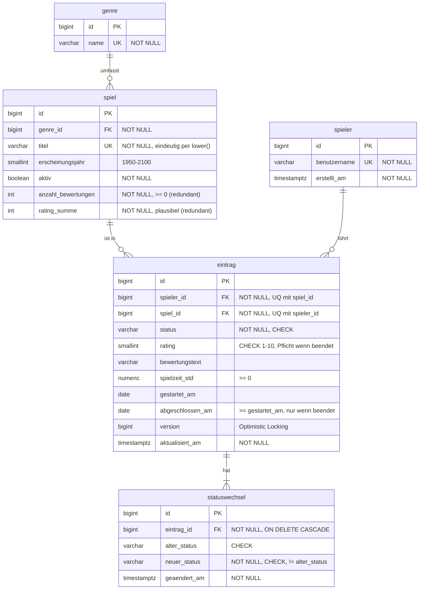

# GameShelf

Projektarbeit **Database Development** · HFTM · Fabio Palma

---

## Inhalt

1. [Thema](#1-thema)
2. [Fachliche Anforderungen](#2-fachliche-anforderungen)
3. [Datenmodell](#3-datenmodell)
4. [Start, Datenbankaufbau und Tests](#4-start-datenbankaufbau-und-tests)
5. [Zentrale Entscheidungen](#5-zentrale-entscheidungen)
6. [Nachweise](#6-nachweise)
7. [Einschränkungen](#7-einschränkungen)
8. [KI und Hilfsmittel](#8-ki-und-hilfsmittel)

---

## 1. Thema

Wer viele Games spielt, verliert schnell den Überblick, welche Spiele bereits gespielt wurden, welche gerade gespielt werden und welche noch geplant sind.

**GameShelf** ist eine REST-API mit Spring Boot und PostgreSQL. Spieler nehmen Games aus einem Katalog in ihre eigene Liste auf, geben einen Status an (*geplant, am Spielen, gespielt, abgebrochen*) und bewerten sie mit 1–10. Optional werden Bewertungstext, Spielzeit sowie Start- und Abschlussdatum gespeichert. Aus den Daten entstehen Auswertungen, z. B. welche Games am besten bewertet oder am häufigsten abgebrochen werden.

**Abgrenzung:** kein Login (Spieler werden über ihre ID angesprochen), kein Frontend, keine Anbindung an externe Spieleplattformen.

**Technik:** Java 25 · Spring Boot 4.1 · Hibernate 7 · PostgreSQL 17 · Flyway · Testcontainers 2

---

## 2. Fachliche Anforderungen

| ID | Anforderung | Geschäftsregel / erwartetes Ergebnis |
|---|---|---|
| A1 | Spielkatalog verwalten | Spiele mit eindeutigem Titel (unabhängig von Gross-/Kleinschreibung) und Genre erfassen, ändern, suchen und deaktivieren. Deaktivierte Spiele können nicht neu aufgenommen werden. |
| A2 | Spiel in eigene Liste aufnehmen | Pflicht: Spiel und Status. Rating 1–10 ist Pflicht bei *gespielt* und *abgebrochen*. Jedes Spiel nur einmal pro Spieler. |
| A3 | Eintrag bearbeiten und entfernen | Abschlussdatum nicht vor Startdatum und nur bei *gespielt*/*abgebrochen*. |
| A4 | Status wechseln mit Verlauf | Jeder Statuswechsel wird protokolliert; beim Abschliessen/Abbrechen werden Abschlussdatum und Spielstatistik aktualisiert. |
| A5 | Eigene Liste durchsuchen | Filter nach Status, Rating und Titel, stabil sortiert, seitenweise. |
| A6 | Spielübersicht anzeigen | Anzahl Bewertungen und Durchschnittsrating je Spiel; es zählen nur *gespielt* und *abgebrochen*. |
| A7 | Auswertungen abrufen | Top-Spiele, Abbruchquote je Genre, Statistik eines Spielers, Abschlüsse pro Monat. |

---

## 3. Datenmodell



**Kardinalitäten:** Ein Genre hat 0..n Spiele, jedes Spiel genau ein Genre. `eintrag` löst die n:m-Beziehung zwischen Spieler und Spiel auf. Jeder Eintrag hat 1..n Statuswechsel (der erste entsteht beim Anlegen).

**View (V2):** `v_beendeter_eintrag` – alle Einträge mit Status *gespielt*/*abgebrochen* inkl. Spieldaten; Grundlage der Auswertungen.

### Schemaentscheidungen

| Entscheidung | Begründung |
|---|---|
| **Normalisierung (3NF)** | Genre, Spiel, Spieler und Eintrag sind getrennt; persönliche Angaben (Status, Rating …) gehören zum Eintrag, nicht zum Spiel. |
| **Bewusste Redundanz** `anzahl_bewertungen`, `rating_summe` | Die Spielübersicht (A6) muss nicht bei jedem Aufruf über alle Einträge aggregieren. Konsistenz wird durch die Transaktion beim Statuswechsel, das atomare Update und den CHECK `ck_spiel_summe_plausibel` gesichert und per Test gegen eine Neuberechnung geprüft. |
| **Regeln als benannte CHECK/UNIQUE-Constraints** | Zentrale Regeln gelten auch, wenn jemand die API umgeht (T1). Die Namen (z. B. `ck_eintrag_rating_pflicht`) werden in verständliche API-Fehlermeldungen übersetzt. |
| **Status als `VARCHAR` + `CHECK` statt PG-`ENUM`** | Funktioniert direkt mit `@Enumerated(STRING)`; neue Werte brauchen kein `ALTER TYPE`. |
| **`GENERATED BY DEFAULT AS IDENTITY`** | SQL-Standard, Nachfolger von `SERIAL`; IDs in Tests setzbar. UUIDs wären für die Datenmenge unnötig gross. |
| **Eindeutiger Titel per `UNIQUE INDEX ON lower(titel)`** | „Zelda“ und „zelda“ sind dasselbe Spiel. |
| **Datentypen** | `SMALLINT` für Rating/Jahr, `NUMERIC(6,1)` für Spielzeit (keine Rundungsfehler), `DATE` für Start/Abschluss (Tag genügt), `TIMESTAMPTZ` für technische Zeitstempel. |
| **`ON DELETE CASCADE` nur bei `statuswechsel`** | Ohne Eintrag ist der Verlauf sinnlos. Spiele werden deaktiviert statt gelöscht, damit Einträge und Statistik erhalten bleiben. |
| **Index nur auf `statuswechsel(eintrag_id)` in V1** | PostgreSQL indiziert Fremdschlüssel nicht automatisch. Weitere Indizes folgen bewusst in eigener Migration, damit der Ausgangszustand für T10 reproduzierbar bleibt. |

---

## 4. Start, Datenbankaufbau und Tests

### Voraussetzungen

- Java 25 (der Maven-Wrapper `./mvnw` lädt Maven selbst)
- Docker Desktop (für die lokale Datenbank **und** für die Tests)

### Datenbank starten

```bash
docker compose up -d          # PostgreSQL 17 auf localhost:5432 (DB/User/Passwort: gameshelf)
docker compose down -v        # Datenbank vollständig löschen (für Neuaufbau)
```

Die Zugangsdaten sind reine lokale Entwicklungswerte und können per Umgebungsvariable überschrieben werden (`DB_URL`, `DB_USER`, `DB_PASSWORD`).

### Anwendung starten

```bash
./mvnw spring-boot:run
```

Beim Start baut **Flyway** die Datenbank automatisch auf (`src/main/resources/db/migration`). Hibernate prüft danach nur, ob Entities und Schema zusammenpassen (`ddl-auto: validate`).

Mit sichtbarem SQL (für die Nachweise T7/T11):

```bash
./mvnw spring-boot:run -Dspring-boot.run.profiles=sqllog
```

### API ausprobieren


Für die reproduzierbaren Nachweise (Pagination, Filter, bekannte Ergebnisse) liegen die Beispielaufrufe zusätzlich unter [`http/`](http/) und laufen in IntelliJ (grüner Pfeil) oder VS Code (Extension *REST Client*). Ab `schritt4.http` prüft jeder Aufruf sein Ergebnis selbst (`client.test`) und läuft auf jeder Datenbank.

| Datei | Inhalt |
|---|---|
| [`http/schritt3.http`](http/schritt3.http) | A1–A3 (auf leerer Datenbank von oben nach unten ausführen) |
| [`http/schritt4.http`](http/schritt4.http) | A4 Statuswechsel und Verlauf |
| [`http/schritt5.http`](http/schritt5.http) | A5 Liste mit Filter, Sortierung, Pagination |
| [`http/schritt6.http`](http/schritt6.http) | A7 Auswertungen mit bekannten Ergebnissen |
| [`http/schritt11.http`](http/schritt11.http) | T12 Cache (erster Zugriff, Treffer, Zugriff nach Änderung) |

### Endpunkte

| Methode | Pfad | Zweck |
|---|---|---|
| POST / GET | `/api/genres` | Genre anlegen / alle Genres |
| POST / GET | `/api/spiele` `?titel=&seite=&groesse=` | Spiel anlegen / Titelsuche |
| GET / PUT | `/api/spiele/{id}` | Spielübersicht inkl. Statistik (A6) / ändern |
| POST | `/api/spiele/{id}/deaktivieren` · `/aktivieren` | Spiel deaktivieren / reaktivieren |
| POST / GET / PUT | `/api/spieler`, `/api/spieler/{id}` | Spieler anlegen / laden / umbenennen |
| POST | `/api/spieler/{id}/eintraege` | Spiel in Liste aufnehmen (A2) |
| GET | `/api/spieler/{id}/eintraege` `?status=&ratingMin=&ratingMax=&titel=&sortierung=&richtung=&seite=&groesse=` | eigene Liste (A5) |
| GET / PUT / DELETE | `/api/eintraege/{id}` | Eintrag laden / ändern / löschen (A3) |
| POST | `/api/eintraege/{id}/status` | Status wechseln (A4) |
| GET | `/api/eintraege/{id}/verlauf` | Verlauf (A4) |
| GET | `/api/auswertungen/top-spiele` `?minBewertungen=&genreId=&limit=` | A7 |
| GET | `/api/auswertungen/abbruchquote-genres` `?minBeendet=` | A7 |
| GET | `/api/auswertungen/spieler/{id}/statistik` | A7 |
| GET | `/api/auswertungen/abschluesse-pro-monat` `?von=&bis=&spielerId=` | A7 |

Fehler werden einheitlich als `application/problem+json` (RFC 9457) geliefert: 400 ungültige Eingabe / Geschäftsregel, 404 nicht gefunden, 409 Konflikt (Duplikat, veraltete Version).

### Tests

```bash
./mvnw test
```

**Voraussetzung:** Docker läuft. Die lokale Datenbank wird **nicht** benötigt – Testcontainers startet für die Tests ein eigenes `postgres:17-alpine`. Laufzeit ca. 10–40 s.

Ergebnis (Stand 04.11.2026):

```
Tests run: 41, Failures: 0, Errors: 0, Skipped: 0
BUILD SUCCESS
```

### Testdaten erzeugen (T9)

```bash
./scripts/testdaten-erzeugen.sh
```

**Achtung:** Das Skript leert zuerst alle Tabellen in der lokalen Datenbank `gameshelf` (`TRUNCATE`) und baut die Testdaten dann neu auf. Erzeugt werden 12 Genres, 5'000 Spiele, 2'000 Spieler sowie **158'555 Einträge** und rund 253'600 Statuswechsel, mit absichtlich schiefen Verteilungen (wenige sehr aktive Spieler, wenige sehr beliebte Spiele, Status- und Jahresverteilung nicht gleichmässig). `setseed(0.42)` macht den Lauf deterministisch – die Prüfsumme am Ende ist bei jedem Aufwand identisch (siehe [`docs/nachweise/t9-testdaten.txt`](docs/nachweise/t9-testdaten.txt)).

---

## 5. Zentrale Entscheidungen

### Architektur

Schichten in eigenen Packages: `web` (Controller, Fehlerbehandlung) → `service` (Geschäftsregeln, Transaktionen) → `repository` (Datenzugriff) → `domain` (Entities). API-DTOs (`dto`) sind Java-Records und von den Entities getrennt; Services geben DTOs zurück, damit Lazy-Beziehungen innerhalb der Transaktion aufgelöst werden. `open-in-view` ist deaktiviert.

### Transaktion (T4)

Die kritische Operation **Status wechseln** (`EintragService.statusWechseln`) umfasst drei Schreibzugriffe in **einer** Transaktion:

1. `UPDATE eintrag` (Status, Rating, Daten)
2. `INSERT statuswechsel` (Verlauf)
3. `UPDATE spiel` (Statistik, atomar `x = x + delta`)

Nach Schritt 1 und 2 wird explizit `flush()` aufgerufen, damit die Änderungen wirklich in der Datenbank ausgeführt sind, bevor Schritt 3 scheitern kann. Scheitert Schritt 3 (z. B. an `ck_spiel_anzahl`), rollt Spring alles zurück.

### Nebenläufigkeit (T5)

| Konflikt | Strategie | Begründung |
|---|---|---|
| Derselbe Eintrag wird auf zwei Geräten gleichzeitig bearbeitet (Lost Update) | **Optimistic Locking**: Client sendet `version`; zusätzlich `@Version` in `Eintrag` → HTTP 409 | Konflikte sind selten (gleicher Spieler, gleicher Eintrag, gleichzeitig). Pessimistic Locking würde jeden Zugriff blockieren. |
| Mehrere Spieler bewerten gleichzeitig dasselbe Spiel (Statistik) | **Atomares Update in der DB** `SET anzahl = anzahl + :delta` | Kein „lesen, rechnen, speichern“ → keine verlorenen Bewertungen, keine Sperre auf Anwendungsebene nötig. |
| Gleichzeitiges doppeltes Aufnehmen desselben Spiels | **Unique-Constraint** `uq_eintrag_spieler_spiel` → HTTP 409 | Die Vorabprüfung im Service kann bei Gleichzeitigkeit nicht alles abfangen; die DB ist die letzte Instanz. |

### Abfragen (T6, T7)

| Anwendungsfall | Zugriffsform | Begründung |
|---|---|---|
| Spielerliste (A5) | **JPQL-DTO-Projektion** (`select new …EintragListenElement`), dynamische WHERE-Klausel | Liest nur die 10 benötigten Felder aus 3 Tabellen in einer Abfrage, keine Entities, kein Lazy Loading. Felder entsprechen direkt dem Domänenmodell. |
| Auswertungen (A7) | **JDBC** (`JdbcClient`) mit parametrisiertem SQL, JOIN und Aggregation | Ergebnis sind Kennzahlen, keine Entities. PostgreSQL-Funktionen (`FILTER`, `ROLLUP`, `date_trunc`) direkt nutzbar; SQL im Code = SQL für `EXPLAIN ANALYZE`. |
| Gemeinsame Basis der Auswertungen | **View** `v_beendeter_eintrag` | Die Regel „nur beendete Einträge zählen“ steht an einer Stelle statt in jeder Abfrage. Normale statt Materialized View → immer aktuell. |
| Einfache Abfragen | Spring Data (abgeleitete Methoden) | Kurz und typsicher. |

Weitere Punkte: Filter werden nur angehängt, wenn sie gesetzt sind (besser optimierbar, keine `NULL`-Typprobleme in PostgreSQL); Benutzerwerte gelangen nur über benannte Parameter in Abfragen; die Sortierung ist eine Whitelist (`EintragSortierung`); `e.id` als zweites Sortierkriterium macht die Reihenfolge stabil; `nulls last` für Einträge ohne Rating; `COUNT(DISTINCT spiel_id)` vs. `COUNT(*)` zählt Spiele und Einträge korrekt getrennt; `ROLLUP` berechnet den Gesamtdurchschnitt über alle Ratings statt als Durchschnitt der Durchschnitte.

### Ladeverhalten (T11)

Alle `@ManyToOne` sind `LAZY` (Standard wäre `EAGER`); es gibt bewusst keine `@OneToMany`-Listen, weil ein Spiel Tausende Einträge haben kann. Die Spielsuche lädt das Genre per `@EntityGraph` mit, die Spielerliste nutzt eine Projektion.

Messung und Vorher/Nachher-Vergleich (N+1 vs. `@EntityGraph`/Projektion, für 5/20/50 Elemente): [`docs/nachweise/t11-ladeverhalten.md`](docs/nachweise/t11-ladeverhalten.md).

### Cache (T12)

Gecacht wird die Auswertung „Top-Spiele“ (teure Aggregation, häufig gelesen, fachlich unkritisch bei kurzer Verzögerung). Schlüssel, Aktualitätsregel und Nachweis (erster Zugriff, Treffer, Zugriff nach Änderung): [`docs/nachweise/t12-cache.md`](docs/nachweise/t12-cache.md).

---

## 6. Nachweise

### Fachliche Anforderungen

| Anforderung | Umsetzung | Nachweis |
|---|---|---|
| A1 Spielkatalog | `SpielService`, `SpielController`, `GenreService` | `EintragRegelnTest` (doppelter Titel, deaktiviertes Spiel) · `http/schritt3.http` |
| A2 Spiel aufnehmen | `EintragService.erstellen` | `EintragRegelnTest` (gültig, ohne Rating, Duplikat) · `http/schritt3.http` |
| A3 Bearbeiten/Entfernen | `EintragService.aendern`, `loeschen` | `EintragRegelnTest` (Rating ändern, veraltete Version, Löschen, Datumsregeln) |
| A4 Statuswechsel mit Verlauf | `EintragService.statusWechseln`, `verlauf` | `StatuswechselTransaktionTest` · `http/schritt4.http` |
| A5 Liste durchsuchen | `EintragListeAbfrage` | `EintragListeTest` · `http/schritt5.http` |
| A6 Spielübersicht | `GET /api/spiele/{id}`, `Spiel.durchschnittsRating()` | `EintragRegelnTest`, `AuswertungTest.redundanteStatistikKonsistent` |
| A7 Auswertungen | `AuswertungAbfrage`, `AuswertungController` | `AuswertungTest` · `http/schritt6.http` |

### Technische Anforderungen

| Anforderung | Umsetzung | Nachweis | Stand |
|---|---|---|---|
| T1 Datenmodell und Integrität | `V1__initial_schema.sql`, ER-Diagramm oben | `EintragRegelnTest.datenbankConstraints` (Regeln direkt per SQL) | ✅ |
| T2 Migrationen | `V1__initial_schema.sql`, `V2__auswertung_view.sql`, `V3__index_abschluesse.sql` | `MigrationTest` (Neuaufbau, V1 → neueste mit Daten) · [Log-Nachweis](docs/nachweise/t2-migrationen.md) | ✅ |
| T3 Anwendung und JPA | `domain/`, `dto/`, `service/`, `web/` | `http/schritt3.http` bis `schritt6.http` | ✅ |
| T4 Transaktion und Rollback | `EintragService.statusWechseln` | `StatuswechselTransaktionTest` (Erfolgsfall; Fehler im 3. Schreibzugriff, Rollback per Sequenz belegt) | ✅ |
| T5 Gleichzeitige Änderungen | `@Version`, Versionsvergleich, atomares Update, Unique-Constraint | `KonkurrenzTest` (4 Tests mit parallelen Threads) | ✅ |
| T6 JPQL-Projektion, JDBC, View | `EintragListeAbfrage`, `AuswertungAbfrage`, `V2__auswertung_view.sql` | `EintragListeTest.projektion`, `AuswertungTest` (bekannte Ergebnisse, `COUNT DISTINCT`) | ✅ |
| T7 Filter, Sortierung, Pagination | `EintragListeAbfrage` | `EintragListeTest` · SQL-Log mit `offset ? rows fetch first ? rows only` (siehe unten) | ✅ |
| T8 Integrationstests | `src/test/java`, Testcontainers | `./mvnw test` → 41 Tests grün | ✅ |
| T9 Testdaten 100'000 | `scripts/testdaten.sql` | [`docs/nachweise/t9-testdaten.txt`](docs/nachweise/t9-testdaten.txt) (158'555 Einträge, Prüfsumme) | ✅ |
| T10 Performance und Index | `V3__index_abschluesse.sql`, `scripts/performance-analyse.sql` | [`docs/nachweise/t10-performance.md`](docs/nachweise/t10-performance.md) (EXPLAIN ANALYZE vorher/nachher) | ✅ |
| T11 ORM-Ladeverhalten | LAZY, `@EntityGraph("genre")`, Projektion | `LadeverhaltenTest` · [`docs/nachweise/t11-ladeverhalten.md`](docs/nachweise/t11-ladeverhalten.md) | ✅ |
| T12 Cache | Caffeine `topSpiele`, `CacheConfig` | `CacheTest` · [`docs/nachweise/t12-cache.md`](docs/nachweise/t12-cache.md) | ✅ |

### Nachweis T7: begrenzte Datenbankabfrage

Aufruf gegen die mit `scripts/testdaten-erzeugen.sh` gefüllte Datenbank (Spieler 1 hat 1'047 Einträge), Anwendung mit Profil `sqllog` gestartet:

```bash
./mvnw spring-boot:run -Dspring-boot.run.profiles=sqllog
curl "http://localhost:8080/api/spieler/1/eintraege?seite=0&groesse=2"
```

Hibernate führt dafür genau **drei** Abfragen aus – keine davon lädt mehr als die angeforderte Seite:

```sql
-- 1. Existenz des Spielers
select count(*) from spieler s1_0 where s1_0.id=?

-- 2. die Seite selbst: JOIN über 3 Tabellen, DB-seitig sortiert, begrenzt
select
    e1_0.id, s1_0.id, s1_0.titel, g1_0.name, e1_0.status, e1_0.rating,
    e1_0.spielzeit_std, e1_0.gestartet_am, e1_0.abgeschlossen_am, e1_0.aktualisiert_am
from eintrag e1_0
join spiel s1_0 on s1_0.id=e1_0.spiel_id
join genre g1_0 on g1_0.id=s1_0.genre_id
where e1_0.spieler_id=?
order by e1_0.aktualisiert_am desc nulls last, e1_0.id desc
offset ? rows fetch first ? rows only
-- Parameter: spieler_id=1, offset=0, fetch=2

-- 3. Gesamtanzahl für totalElemente/totalSeiten
select count(e1_0.id) from eintrag e1_0 where e1_0.spieler_id=?
```

Antwort bei `seite=0&groesse=2`: `"totalElemente":1047,"totalSeiten":524` – von den 1'047 Einträgen des Spielers werden nur die angeforderten 2 tatsächlich samt Spiel- und Genredaten aus der Datenbank geladen, nicht alle 1'047 im Speicher gefiltert.

---

## 7. Einschränkungen

- Kein Login: Jeder Aufrufer kann jeden Spieler ansprechen (bewusst ausserhalb des Umfangs).
- Spieler können nicht gelöscht werden (Fremdschlüssel ohne Cascade, um Einträge und Statistik zu schützen).
- Die Titelsuche mit `like '%…%'` kann keinen normalen B-Tree-Index nutzen; für sehr grosse Kataloge wäre ein Trigram-Index (`pg_trgm`) nötig.
- Pagination per `OFFSET` wird bei sehr hohen Seitenzahlen langsamer; für Endlos-Listen wäre Keyset-Pagination besser.
- `http/schritt3.http` setzt eine leere Datenbank voraus (feste IDs); die übrigen `.http`-Dateien laufen auf jeder Datenbank.

---

## 8. KI und Hilfsmittel

Für diese Arbeit wurde KI unterstützend eingesetzt, gemäss *HFTM-KI-Richtlinien für Studierende, Version 1.1 vom 02.02.2026*.

| Dokument | Datei |
|---|---|
| Eigenständigkeitserklärung inkl. Erklärung des KI-Einsatzes | [`docs/eigenstaendigkeitserklaerung.md`](docs/eigenstaendigkeitserklaerung.md) |
| Hilfsmittelverzeichnis (Werkzeug, Zweck, betroffene Dateien, Version/Datum) | [`docs/hilfsmittelverzeichnis.md`](docs/hilfsmittelverzeichnis.md) |
| Kennzeichnung KI-Einsatz je Stelle/Datei, Herkunftsangaben | [`docs/ki-einsatz.md`](docs/ki-einsatz.md) |

Übernommene technische Grundstrukturen aus dem Unterricht sind an den betroffenen Stellen mit Herkunftsangabe gekennzeichnet.
